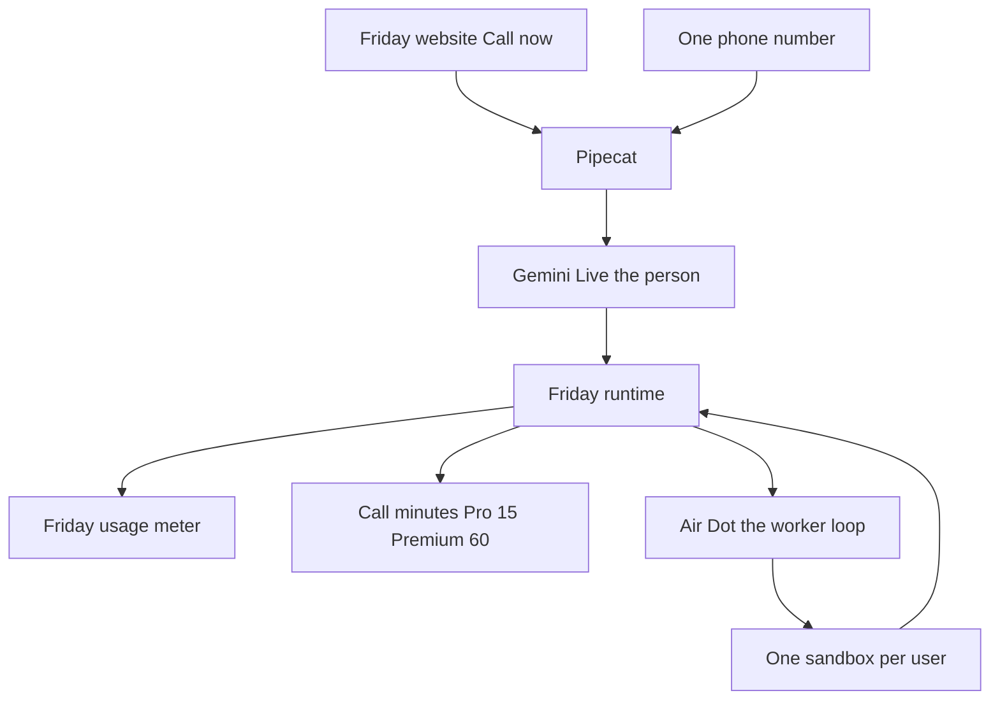
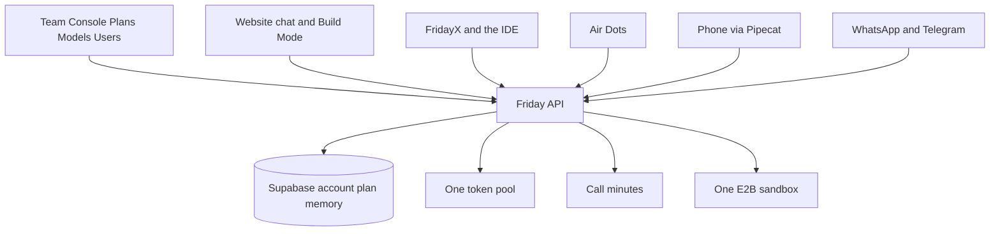
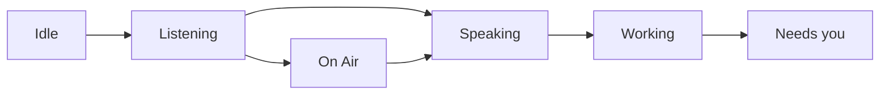

# Air Dots

Friday is the product. Air Dots is the always-on computer inside Friday, and the call that drives it.

The person on the phone is Friday. The button on the website says **Call now**. The surface that button opens is **On Air**. There is no second app, no second login, and no second usage meter for the work. Call minutes are the only extra limit, and they show up only on Pro and Premium.

This replaces the earlier "Friday line" name. The runtime, the hold-or-release rule, the persona, and the call memory still stand. They now sit under Air Dots.

## What we looked at

| System | What it actually is | What Air Dots keeps | What we leave |
|---|---|---|---|
| OpenDots | Always-on coworkers, each with a computer, text and calls sharing one context | Call stays up only for the talk. The computer keeps working. Approval before a save or a send. | A new workspace, Spaces, Slack, and one computer per specialist |
| OpenBot | Any agent, one gateway that allows and records every computer action, one container per coworker | One gate in front of the browser, the shell, and files. An audit row for every action | Thirteen example bots and a second product to sign into |
| Rakazo | Persistent teammates, a private computer, routines, voice, web plus desktop plus mobile | One computer per user, paused when idle, routines, the web as the home | Electron, Expo, and a bring-your-own meter |
| Coucou | A notch pet that watches coding sessions on your Mac | Tell the person when Friday needs them | A desktop mascot |
| Grok build | A loop that keeps going, with a graph of the work, until the task is done | That loop, inside the user's sandbox, until the job is done or the meter is empty | A separate CLI product for this feature |

Air Dots is not a clone of any of these. It is Friday's existing account, Friday's existing meter, and Friday's existing sandbox, with a loop that does not die when the call ends.

## The shape

Two brains, on purpose.

- **Friday on the call** is Gemini Live, audio to audio. She talks, she listens, she stops. She does not run the computer.
- **The Air Dot** is the worker. It is the same kind of loop Grok build uses: tools, a graph of the job, and it keeps going until the task is done. It runs in the user's sandbox. Its tokens come out of the Friday usage meter, the same meter as chat and Build Mode.

The call can start a job, hear a short result, or hang up while the Dot keeps working. When the job is done, or when they asked to be called, Friday rings them.

## Where a call lands

A call is not a second Friday. The words and the work land in the workspaces Friday already has.

The database already marks each conversation as `chat` or `build` (`conversations.workspace`). Air Dots uses that.

- Talk, research, mail, a reminder, an order: the transcript and the result open in the **chat workspace**, the same list as a website chat.
- A coding job: the same conversation is a **Build workspace**. It shows in Build Mode history, with the files, the diff, and the sandbox. FridayX and the IDE, when it ships, open that same project. They do not start a second machine.

Air Dots on the website is those two workspaces plus the call, the computer screen, and the channels. It has Build Mode because it is Friday's Build Mode, not a copy. The person can keep going from the thread after they hang up. WhatsApp and Telegram are more doors into the same conversation.

## How it connects

Friday is one account, the way Google is one account for Gmail and Drive. The website, Build Mode, FridayX, Air Dots, and the phone are doors. They do not each keep a user, a meter, or a sandbox.

The main backend is the Express API already in `backend/`. Nothing new becomes a second server.

| Door | Route it uses | What it shares |
|---|---|---|
| Website chat | `/api/chat` | Account, memory, token pool. Ledger feature `chat` |
| Build Mode | `/api/build` | Same account, same sandbox, same token pool. Ledger feature `build` |
| FridayX | `/api/x` | Same account and same token pool. Ledger feature `code` |
| Air Dots | `/api/air` | Same account, same memory, same sandbox, same token pool. Ledger feature `air` |
| Phone | Pipecat calls `/api/air` | Same session as Air Dots. Call minutes are the only extra counter |
| WhatsApp, Telegram | `/api/air` | Same conversation, same memory, same sandbox. Updates go out here |

`air` is a label on the ledger so the admin can see how many of the 10 million or 25 million tokens the Dot used. It is not a second wallet. Chat, Build Mode, and Air Dots stop together when the plan's token pool is empty.

The phone gateway is a thin client of that API. It does not own users, memory, or the sandbox. A turn on a call is the same agent turn Build Mode and chat already run.

### Admin panel

The Team Console, the admin panel at `/admin`, is the only editor. Plans, Models, and Users are the three screens that matter.

**Plans.** One row for Pro at ₹999 and one for Premium at ₹1,999. On that row: the token pool (10 million or 25 million), the call minutes (15 or 60), whether Call now is visible, and the sandbox awake cap. Saving the row updates the API. The website, Build Mode, FridayX, and the phone read it on the next request. No app release, no second config.

**Models.** Which model Build Mode and the Air Dot use, and which voice the call uses. Gemini Live first. Grok audio is a switch here, not a code change.

**Users.** The person's plan, tokens left, call minutes left, whether a passphrase is set, whether WhatsApp or Telegram is linked, and whether their sandbox is awake or paused. Support can see a call and a build on the same account because both wrote to the same ledger.

**Product updates.** This screen already exists. A teammate writes a title, a body, a button, an audience (everyone, free, Pro, Premium), and the platforms. Today those platforms are web, Android, and iOS. Air Dots adds three: the Air Dots page, WhatsApp, and Telegram. One publish. The same card can show on the website, pop once inside Air Dots, and go out on the channels the person has turned on.

**Featured.** One slot on the Air Dots home, the same update marked featured. It is a card, not a second ad product. Email campaigns stay on the Marketing screen they already have. A featured card inside the product costs us nothing. A marketing template on WhatsApp is about ₹1.02 per person after GST, so that blast is a choice in the same editor, not the default.

A plan change in that panel is the whole ecosystem. Turn Call now on for Pro and the button appears. Raise the token pool and chat, Build Mode, and Air Dots all get the extra tokens. Pause a user's sandbox from Users and the Dot stops with the work kept. Publish an update and it reaches the page, the phone channels, and the apps from that one row.

## The sandbox

Friday already has this. One E2B machine per user, paused when idle, resumed next time, with files and browser logins kept. Air Dots uses that machine. It does not create a second one.

Cost control is a limit, not a new product:

- Idle for the admin limit, starting at 8 minutes with no step running, and the machine pauses.
- The job does not disappear. The next step resumes the same machine.
- A hard awake cap per day stops a runaway loop from holding a machine open. The work is kept. Friday says the meter or the cap stopped it.
- Shell, browser, and files never run on Friday's own server. If the sandbox is down, the tool fails clearly.

The sandbox is how Friday uses a browser, logs into a site, uses a connector, runs a skill, and uses Build Mode. Zomato, Swiggy, and Walmart are not plugins. They are sites in that browser. Friday can search, click, and fill. She asks before she pays, sends, or deletes. The passphrase covers that yes when the action leaves the account.

## The screen

The person can see that computer and use it. Air Dots shows the sandbox desktop on the website and in the phone app. Web uses the mouse. The phone uses a finger as the cursor: tap, drag, type. They can drop a file onto the screen and add it to the machine.

This is the same E2B machine, streamed into the page. It is not a second computer and not a remote-desktop app to install. While they are looking, the machine stays awake. When they leave and the loop is idle, the 8-minute pause still applies.

Logins happen on this screen. Friday never asks them to paste a password into WhatsApp, Telegram, or the call. The channel only says she is waiting and offers to open the screen.

## The loop

The Air Dot is not a scheduled prompt. Friday already has those automations. An Air Dot is a job with a graph:

- It plans the steps.
- It runs them in the sandbox.
- It checks the result and continues.
- It stops when the task is done, when the person says "rukho" or "stop", or when the Friday usage meter is empty.

Scheduling and automations stay. "Every morning, order nothing, just tell me the traffic" is still an automation. "Book the table, then message them, then stop" is an Air Dot that runs until that graph is done. Both write into the same Friday thread. Both spend the same usage meter.

The model behind the loop is chosen in the Team Console. Do not bake Fable, Astra, or any other name into the client. Start the loop on the same model Build Mode already uses, so the power and the bill match a job the person could have typed. Swap the model in admin when you pick Fable, Astra, or whatever wins the test. The voice model is not this model.

## The call

### Call now

On the Friday website, **Call now** sits on On Air. The click places a call to the mobile number on the account. Friday is already talking when they pick up. The website stays the home. No new app.

### They call Friday

One number. India and international are two trunks on that same gateway, not two products.

- India: an Exotel number.
- Everywhere else: Telnyx or Twilio.
- Pipecat is the pipe between that number and Gemini Live. Pipecat does not sell the number.

A personal Jio SIM can prove one inbound call on a desk. It cannot be the number users call. It will not route, record, or scale, and it will not cover a user outside India.

### Who is calling

The caller ID matches the verified number on the account. That is the login. Unknown numbers hear one sentence and the call ends.

A passphrase is for the moments that need a second check, not for every hello. The person sets it by talking: "my passcode is jagga jasoos." Friday stores a hash. She asks for it before a payment, a send, or a delete, and when a call arrives from a number that is not on the account yet. They can change it the same way.

### Plans

One token pool per plan. Chat, Build Mode, and Air Dots all spend it. Call minutes are the only extra counter, and they show only when that plan is selected.

| Plan | Price | Tokens each month | Call minutes | Call now |
|---|---|---|---|---|
| Free | — | the free allowance Friday already has | none | Hidden |
| Pro | ₹999 | 10 million | 15 | Shown |
| Premium | ₹1,999 | 25 million | 60 | Shown |

A loop that runs for an hour after hang-up spends tokens, not call minutes. Only the time the phone line is up spends call minutes.

### WhatsApp and Telegram

Air Dots is on WhatsApp and Telegram as well as the website and the phone. Same account, same memory, same sandbox, same token pool. The person links the chat once in settings. After that they can start a job from either app, and Friday can send the update there.

Telegram's bot API has no per-message fee. WhatsApp is Meta's Business Platform, billed per delivered message in India from 1 October 2026:

- Utility (a job update, "sign in to continue"): ₹0.115, about ₹0.136 with GST
- Service replies inside the 24-hour window: the first 1,000 a month on our number are free, then the same ₹0.136
- Marketing (a featured blast): ₹0.8631, about ₹1.02 with GST

Job updates are utility. Ads are marketing, and they stay off unless someone publishes that choice in the admin. The 1,000 free service replies are for the whole business number, not per user, so a busy month treats WhatsApp replies as paid.

### When she needs a login

The Dot hits a sign-in wall. She does not invent the password and she does not read it out.

1. A card opens in the chat workspace, or in Build Mode if the job is code, with the screen ready.
2. The same ask goes to WhatsApp and Telegram if they are linked: what she needs, and a button to open the screen or reply.
3. If nobody answers and the job was marked urgent, she calls. The call spends minutes. She says what is blocking and waits.
4. They finish it on the screen, from the thread, from WhatsApp, or from Telegram. One yes updates the same job. She does not ask four times.

### What a month costs us

Three bills, added together. Rates below are published list prices, converted at ₹84 per dollar. They are our cost, not the price the user pays.

**1. Tokens.** The pack in hand is ₹250 for 10 million tokens, every model. That is ₹25 per million. Chat, Build Mode, FridayX, the IDE, and the Air Dot share the plan's pool, so a full burn costs:

- Pro, 10 million: ₹250
- Premium, 25 million: ₹625

The public price of Fable or Astra does not matter while this pack covers them. The model stays an admin switch so a later pack can be swapped without a release. Live call audio is not in this pack. A token is not a phone minute. Gemini Live plus the trunk stays the call bill below.

**2. Sandbox.** E2B charges only while the machine is awake. Paused time is ₹0. Friday creates the sandbox without a custom size, so the default is 2 vCPU. At E2B's published rate, $0.0504 per vCPU-hour and $0.0162 per GiB-hour, 2 vCPU and 0.5 GiB is about $0.11 an hour, about ₹9. A browser wants more memory. At 2 vCPU and 2 GiB it is about $0.13 an hour, about ₹11.

| Awake time in a month | About our cost |
|---|---|
| 2 hours | ₹18 to ₹22 |
| 10 hours | ₹90 to ₹110 |
| 40 hours | ₹360 to ₹440 |

The 8-minute idle pause is what keeps a user off the 40-hour row. A daily awake cap should sit near 20 minutes on Pro and 45 minutes on Premium, so a heavy month of sandbox is about ₹90 to ₹250, not a bill bigger than the plan.

**3. The call.** Gemini 3.8 Live is about $0.005 a minute of audio in and $0.018 a minute of audio out. With the India phone trunk, about ₹0.5 to ₹1.5 a minute, plan on ₹3 to ₹5 of direct cost per connected minute once session compression is on. Without compression Gemini re-bills audio still in the session and a long call costs more.

| Plan | Call minutes | Call cost at ₹3 to ₹5 |
|---|---|---|
| Pro | 15 | ₹45 to ₹75 |
| Premium | 60 | ₹180 to ₹300 |

**4. WhatsApp.** Telegram is ₹0. A heavy Air Dots user, about 200 of our replies plus 30 job updates, is about ₹30 to ₹40 after GST. A quiet user is under ₹10. A featured marketing blast is about ₹1.02 a person and is not part of normal running.

**A full month, if they use the whole allowance.** High end of each line. Awake cap is 20 minutes a day on Pro (10 hours) and 45 minutes a day on Premium (22.5 hours), at about ₹11 an hour for a browser-sized machine.

| | Pro ₹999 | Premium ₹1,999 |
|---|---|---|
| Tokens, whole pool | ₹250 | ₹625 |
| Call, whole allowance at ₹5 | ₹75 | ₹300 |
| Sandbox, whole awake cap | ₹110 | ₹250 |
| WhatsApp, heavy | ₹40 | ₹40 |
| Telegram | ₹0 | ₹0 |
| Our cost | about ₹475 | about ₹1,215 |
| Left, before GST | about ₹524 | about ₹784 |
| Margin | about 52% | about 39% |

If ₹999 and ₹1,999 include 18% GST, the cash we keep is about ₹847 and ₹1,694. Profit then is about ₹370 on a full Pro month and about ₹480 on a full Premium month. Still above zero when the person uses everything.

A light month is where the plan actually earns. Two million tokens (₹50), five call minutes (₹25), two sandbox hours (₹22), and a little WhatsApp (₹10) cost about ₹107. Left on Pro is about ₹890. Left on Premium, same light use against ₹1,999, is about ₹1,890.

Every full-burn subscriber is still profitable at this token price. The loss case is a Premium user who also sits past the awake cap, or a marketing blast on WhatsApp with no plan behind it. The cap and the featured switch exist so those stay choices.

Fixed, on top of Friday's servers, which we already pay: one India number rental, plan about ₹1,500 a month until Exotel quotes it, and one international number at a few dollars. That rental is covered by the first four Pro subscribers even if each of them burns the whole plan.

Short work, about 5 to 10 seconds, stays on the line. She says she is getting it, then speaks the result. Longer work leaves the line. "Stay with me" is allowed and spends minutes.

Grok audio-to-audio can replace Gemini Live later from the same admin switch, if its speech API is the one you want in production. Do not block the first build on it. Pipecat can point at either.

## Memory

One memory per user. The website, Build Mode, the Air Dot, the phone, WhatsApp, and Telegram all read and write it. A call does not have a private memory, and a channel does not have a second one. The key is the verified account, not the raw phone number.

It keeps everything that user has said and everything Friday has done for them:

- Chat on the website, in the chat workspace or the Build workspace
- What they said on every call, the full transcript
- What they said on WhatsApp and Telegram
- What the Air Dot did, the steps and the result
- Names, preferences, open loops, and the passphrase hash

The next call and the next Air Dot run both start from that store. She can pick up a job from last week, a detail from a call, or a fact they told the website. She does not introduce herself again, and she does not ask for something they already gave her.

What a single call holds in its live audio session is the part that matters for this conversation, pulled from that full store. The store itself is not trimmed. Raw audio from old calls is not replayed into Gemini, because that re-bills every minute and will kill the line. The words are saved. She recalls the words.

She does not open a call by reading the archive aloud. If they ask "what did I tell you", she answers from the store. A curious beat may use one real detail, then she waits.

Memory never grants a payment or a send.

## The mascot

OpenDots puts a character on the chat and on the call, and changes it with a state: idle, listening, speaking. OpenAI's voice screen is an animation that moves with the audio. Friday gets one of those, on the website she already has. It is not a second character and it is not a desktop pet.

Her name on screen is Friday. One design, not a set of colored specialists. A Rive animation, one rig, driven by the session:

- **Idle.** A slow breathe while the page is open and nothing is running.
- **Listening.** She reacts to their voice or their typing.
- **Speaking.** The same rig follows her audio on a call.
- **Working.** The Air Dot is in the sandbox. She stays on the thread, small, so they can see the job is still alive after the call ends.
- **Needs you.** A payment, a send, or a delete is waiting for a yes.
- **On Air.** The call is live. Call now is no longer the label. The mascot is the call.

She sits in the thread, beside Call now, and fills the call screen. The phone itself has no picture. The voice is the same person. If the website is open during a call, the mascot is On Air there too.

Coucou's notch pet stays out. That is a second app sitting on the Mac menu bar. This mascot lives inside Friday's page.

## How she sounds

This is the system prompt, not a voice vendor setting.

Short spoken sentences. One idea, then stop. English or Hindi. A real reaction to the last thing they said, then the task. One question at a time. One curious beat when the job allows it, specific to what they just said, then silence. No "sure", no "anything else?", no fun facts. She does not talk over them. Barge-in cuts her mid-sentence.

She should feel like a sharp person who is sitting there for them. Friendly, a little curious, never a menu.

## What she can do

Anything the sandbox and Friday's connectors can already do, plus the jobs the loop finishes after the call:

- Build Mode, documents, research, mail, skills
- Browser search and any site the person can log into
- Connectors Friday already has
- Schedules and automations
- An order on Zomato, Swiggy, or Walmart, stopped for a spoken yes before money moves

No plugin is added per website. If a site has no connector, the sandbox browser is the connector. If Friday is missing a tool, it is one tool on the existing runtime, not a new app.

## What not to add

- A Friday Air app, a dots app, or a second install
- A new meter for agent work
- A computer per specialist
- A personal SIM as the public number
- The voice model running the long loop

## Build order

1. **The Air Dot in the workspaces.** A job that loops in the existing sandbox until it is done, paused, or out of meter. The transcript lands in the chat workspace. A coding job lands in Build Mode. Idle pause and the awake cap. No phone required.
2. **The screen.** The same machine, visible on web and mobile, with a cursor and a way to drop files in.
3. **The gate.** Every browser, shell, and file action is allowed and recorded. Pay, send, and delete wait for a yes. A login ask opens the screen and the same card on every linked channel.
4. **WhatsApp and Telegram.** Link once. Start a job there. Receive the update there.
5. **Call now, outbound only.** Pipecat, Gemini Live, Exotel, the verified number, the 15 and 60 minute counters, hidden unless the plan is Pro or Premium.
6. **The inbound number.** Caller ID login, passphrase for the dangerous yes, India plus international trunks.
7. **She rings back** when the Dot finishes, when they asked, or when an urgent login has had no answer, inside the remaining minutes and quiet hours.
8. **Admin.** Air Dots, WhatsApp, and Telegram as platforms on the product-update screen, plus one featured slot.

The computer is real at step 1. The website gets Call now at step 5.
