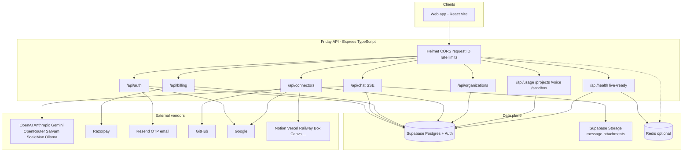
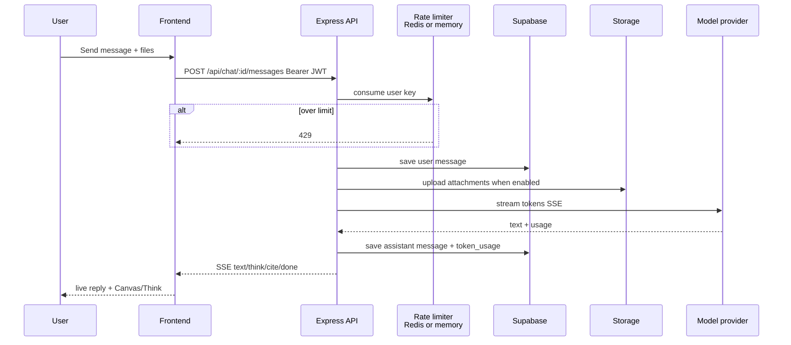
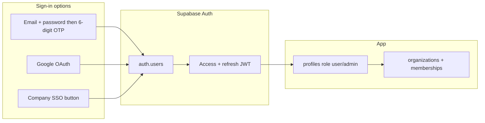
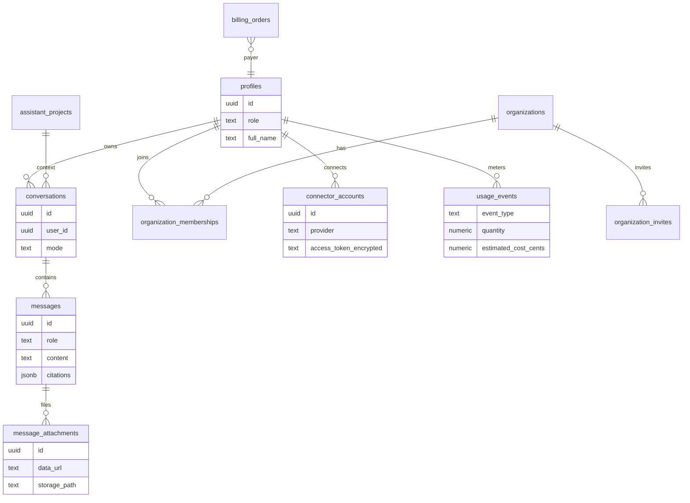
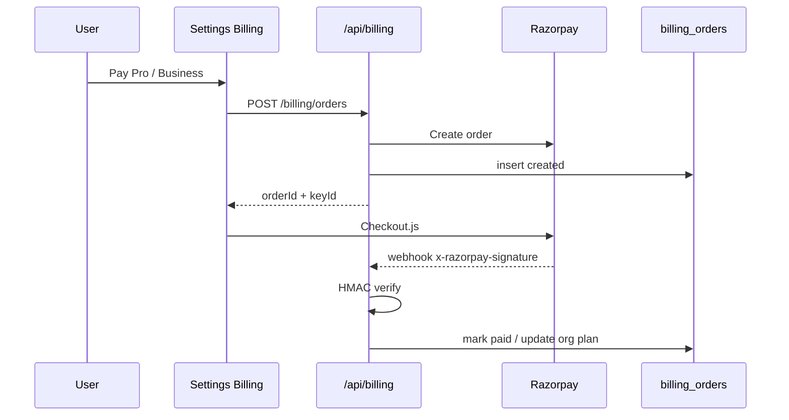

# Friday AI — Platform briefing

> **Update (branch `claude/architecture-analysis-p7x2lr`):** Friday is now an agent platform — native tool
> calling, connector + MCP tools, code execution, Deep Research, long-term memory, Automations, chat search,
> share links, and a Build Mode coding agent that opens GitHub PRs. Migrations now run to `0027`. See
> [`UPGRADE_ROADMAP.md`](../product/UPGRADE_ROADMAP.md) and diagrams 11–14 in [`diagrams/`](../diagrams/README.md);
> the sections below describe the platform as of PR #2.

**Audience:** leadership and engineering  
**Branch:** `cursor/cloud-agent-1789643679414-qaev6`  
**PR:** https://github.com/billionairestechnologies/Friday-ai/pull/2  
**Head commit:** `6168a05` — *feat: complete Google sign-in and remaining connectors*  
**Base:** `main`

**Downloadable diagrams (PNG / SVG / PDF via HTML):** see [`docs/diagrams/`](../diagrams/README.md) and the boss pack [`docs/diagrams/BOSS_COPY.md`](../diagrams/BOSS_COPY.md).

---

## 1. One-page summary (for leadership)

Friday AI is now a production-shaped assistant platform, not only a chat UI.

| Area | What we built |
|---|---|
| **Security** | Production config checks, request IDs, rate limits, concurrency caps, hashed OTPs, readiness/liveness, graceful shutdown |
| **Data** | Server-owned chats, attachments, export/delete, pagination |
| **Ops** | 14 numbered SQL migrations, CI, Docker, runbook, structured logs |
| **Teams** | Organizations, roles, invites, budgets, audit logs, usage dashboard |
| **Work modes** | Personal / Work / Developer projects with persistent instructions |
| **Billing** | **Razorpay** (not Stripe): orders, webhook verify, Settings checkout |
| **Scale** | Redis limits (memory fallback), Supabase Storage for files |
| **Identity** | Email + OTP, Google sign-in, company SSO entry button |
| **Connectors** | GitHub + Google OAuth; Notion, Supabase, Railway, Vercel, Razorpay, Box, Canva, Finance via verified tokens |
| **Cost control** | Token usage + estimated cost per model call |

**What is still on you (ops, not code):** put secrets in the environment, apply migrations `0001`–`0014` on Supabase, and (optional) create a company SSO provider in the Supabase Auth dashboard.

---

### Friday X — the coding agent for terminals and editors

Friday X (`friday`) is a second front door to the same platform: a terminal agent and editor integrations (VS Code
extension; JetBrains, Zed and other ACP editors via `friday agent stdio`). It is a modified fork of an open-source
(Apache-2.0) coding-agent harness, in `cli/`, with the original vendor's login, models, telemetry and services
removed, and Friday's put in their place.

- **Account, plan and models come from the backend.** Sign-in is a browser device-code flow against `/api/x`; the
  model list, per-plan access, limits and even the client's own settings are fetched at runtime. A change made in
  the Team Console reaches every installed terminal and editor with no update.
- **One meter.** Every terminal turn is metered through the same credit accounting as chat (feature `code`), so usage
  anywhere drains the one bar users see on web and mobile.
- **Admin control.** `fridayX` is an entitlement (Console → Plans), set per plan, package or person; it is checked on
  every request.
- **Install.** One line per OS (`/x/install.sh`, `/x/install.ps1`, `/x/install.cmd`); binaries are checksum-verified
  and `friday update` upgrades in place.
- **Private.** No telemetry or analytics; the client talks to the Friday backend and nothing else.

See [`../product/FRIDAY_X.md`](../product/FRIDAY_X.md) and diagrams 19-22.

## 2. System diagram (whole product)



---

## 3. Request path (how a chat turn works)



---

## 4. Identity and access



**Login rules**
- Email/password never returns a session until OTP is confirmed.
- Google creates or reuses the Supabase user, then hands the browser a session in the URL hash (`#friday_session=`), which the app stores locally.
- SSO is a deep-link into the IdP URL you configure. The IdP itself is created in **Supabase Dashboard → Authentication → Providers**.

---

## 5. Data model (what lives where)



**Migrations to apply in order:** `0001` … `0014` under `supabase/migrations/`.

---

## 6. Connectors

| Plugin in UI | How it connects | What Friday verifies |
|---|---|---|
| GitHub | OAuth | GitHub user + repos |
| Calendar / Gmail / Drive | One Google OAuth | Google profile |
| Notion | Integration token | `GET /v1/users/me` |
| Supabase | Project URL + key | REST ping |
| Railway | API token | GraphQL `me` |
| Vercel | API token | `/v2/user` |
| Razorpay (plugin) | Key ID + secret | Payments list |
| Box | Developer token | `/users/me` |
| Canva | Access token | `/users/me` |
| Finance | API token | Stored encrypted (no third-party ping) |

Tokens are encrypted with `KEY_ENCRYPTION_SECRET` (AES-256-GCM) before they hit Postgres. They are never shown back in the UI.

Razorpay **billing** (Settings → Billing) is the **platform** payment account. Razorpay **connector** is the **user's** Razorpay keys for tracking their own payments.

---

## 7. Billing (Razorpay)



Without `RAZORPAY_*` keys, the UI still lists plans but Pay stays disabled.

---

## 8. Folder map (for engineers)

```
Friday-ai/
  frontend/                 React + Vite UI
    src/components/         chat, settings, plugins, login
    src/lib/auth/           session, Google hash, OTP
    src/lib/chat/           store, SSE client, projects
  backend/
    src/app.ts              HTTP wiring
    src/config/env.ts       env validation
    src/middleware/         auth, rateLimit, errors
    src/routes/             /auth /chat /billing /connectors /organizations ...
    src/services/           chat, providers, billing, connectors, usage
    src/services/providers/ one adapter per model vendor
  supabase/migrations/      0001–0050
  cli/                      Friday X (Rust agent, binary 'friday')
  ide/                      editor integrations (VS Code extension, ACP setup)
  docs/operations/OPERATIONS.md        deploy + incident runbook
```

**Local mental model**
- Frontend talks only to `/api/*` with a Bearer JWT.
- Backend is the only process that holds service-role, provider keys, and Razorpay secrets.
- Model keys live in the admin panel (encrypted), not in `.env`, except platform secrets listed below.

---

## 9. What you must configure

Copy `backend/.env.example` → `backend/.env` (and production secrets store).

### 9.1 Required to boot in production

| Variable | Why |
|---|---|
| `NODE_ENV=production` | Turns on strict secret checks |
| `SUPABASE_URL` | Database + Auth |
| `SUPABASE_SERVICE_ROLE_KEY` | Server-side DB/Auth (never ship to the browser) |
| `SUPABASE_ANON_KEY` | Login handshake |
| `KEY_ENCRYPTION_SECRET` | ≥ 32 unique bytes; encrypts provider and connector secrets |
| `RESEND_API_KEY` | OTP emails |
| `CORS_ORIGIN` | Your real web origin(s), comma-separated |
| `PUBLIC_APP_URL` | Where OAuth returns the user |
| `PUBLIC_API_URL` | Where OAuth callbacks hit the API |

Also apply SQL `0001` through `0014` on the Supabase project **before** deploying this branch.

### 9.2 Strongly recommended

| Variable | When |
|---|---|
| `TRUST_PROXY=1` | Behind Railway/Vercel/Nginx |
| `REDIS_URL` | More than one API instance |
| `RESEND_FROM_EMAIL` | After you verify a sending domain |
| `ATTACHMENT_OBJECT_STORAGE=true` | Default; stores files in bucket `message-attachments` |

### 9.3 Feature flags (optional, enable when ready)

**Google sign-in + Calendar/Gmail/Drive**
1. Google Cloud Console → OAuth client (Web).
2. Authorized redirect URIs:
   - `{PUBLIC_API_URL}/api/auth/google/callback`
   - `{PUBLIC_API_URL}/api/connectors/google/callback`
3. Set `GOOGLE_CLIENT_ID`, `GOOGLE_CLIENT_SECRET`, `GOOGLE_LOGIN_REDIRECT_URI`, `GOOGLE_CONNECTOR_REDIRECT_URI`.

**GitHub connector**
1. GitHub → Developer settings → OAuth App.
2. Callback: `{PUBLIC_API_URL}/api/connectors/github/callback`
3. Set `GITHUB_CLIENT_ID`, `GITHUB_CLIENT_SECRET`, `GITHUB_REDIRECT_URI`.

**Razorpay billing**
1. Razorpay Dashboard → API keys + webhook.
2. Webhook URL: `{PUBLIC_API_URL}/api/billing/webhook`
3. Set `RAZORPAY_KEY_ID`, `RAZORPAY_KEY_SECRET`, `RAZORPAY_WEBHOOK_SECRET`.

**Company SSO**
1. Supabase Dashboard → Authentication → add SAML/OIDC IdP.
2. Copy the start URL into `SSO_ENTRY_URL`.
3. `SSO_ENABLED=true`, `SSO_PROVIDER_LABEL=Your Company`.

**Search / sandbox**
- `TINYFISH_API_KEY` — live web search (otherwise DuckDuckGo fallback).
- `E2B_API_KEY` — code sandbox.

**Model providers** (OpenAI, Anthropic, Gemini, …) are **not** env vars. Admins paste keys in the Friday admin panel.

### 9.4 Rate-limit knobs (defaults are fine)

`AUTH_RATE_LIMIT_MAX`, `OTP_RATE_LIMIT_MAX`, `CHAT_RATE_LIMIT_MAX`, `CHAT_DAILY_LIMIT_MAX`, `CHAT_CONCURRENCY_MAX`, plus voice/sandbox equivalents.

---

## 10. Go-live checklist

1. Create/select a Supabase project. Enable Auth. Turn on PITR backups on paid plans.
2. Run migrations `0001`–`0014`.
3. Confirm Storage bucket `message-attachments` exists (created by `0012`).
4. Fill production env (section 9.1).
5. Deploy API + frontend (one image: backend serves `frontend/dist`).
6. Hit `GET /api/health/ready` — expect `database: ok` (and `redis: ok` if `REDIS_URL` is set).
7. Smoke test: signup → OTP email → chat → attach a file → Settings → Usage.
8. Enable Google / GitHub / Razorpay / SSO only after their redirect URLs match production.

**Deploy order:** migrate staging → verify → migrate production → deploy code → check readiness. Roll **code** back first; fix data with a new forward migration, never by editing old SQL files.

---

## 11. How to self-learn in the repo

| If you want to understand… | Start here |
|---|---|
| HTTP surface | `backend/src/app.ts` |
| Env rules | `backend/src/config/env.ts` |
| Login / OTP / Google | `backend/src/controllers/authController.ts`, `backend/src/services/googleAuth.ts` |
| Chat streaming | `backend/src/services/chat/index.ts` |
| Model vendors | `backend/src/services/providers/` |
| Limits | `backend/src/middleware/rateLimit.ts` |
| Billing | `backend/src/services/billingService.ts` |
| Connectors | `backend/src/services/tokenConnectors.ts`, `connectorService.ts` |
| Teams | `backend/src/services/organizationService.ts` |
| Usage / cost | `backend/src/services/usageService.ts`, `tokenUsage.ts` |
| UI settings / billing / team | `frontend/src/components/settings-modal.tsx` |
| UI plugins | `frontend/src/components/plugins-drawer.tsx` |
| Schema history | `supabase/migrations/` |
| Incidents / rollback | `docs/operations/OPERATIONS.md` |

**Verify locally**

```bash
npm run verify:migrations
npm --prefix backend test
npm run typecheck
npm run build
```

---

## 12. Honest limitations (so nobody is surprised)

- Token **cost** is an internal budget estimate, not a Razorpay invoice.
- Finance connector stores an encrypted token; it does not pull live bank data until a provider is chosen later.
- Company SSO needs an IdP record in Supabase; the app only shows the button and link.
- npm audit is currently clean; keep it that way on future upgrades.
