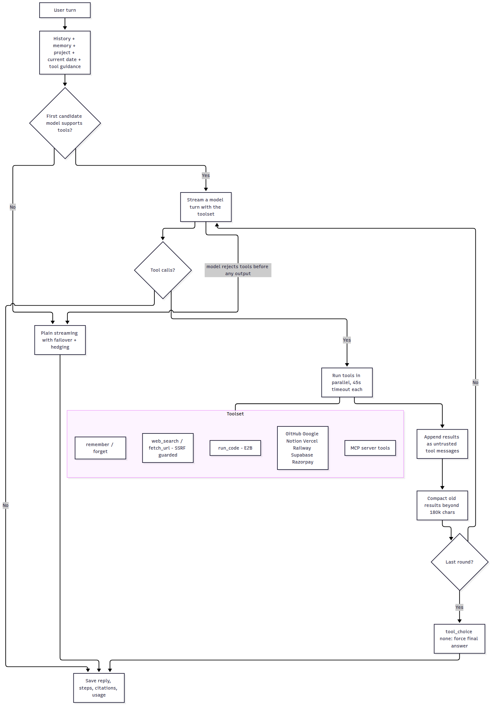
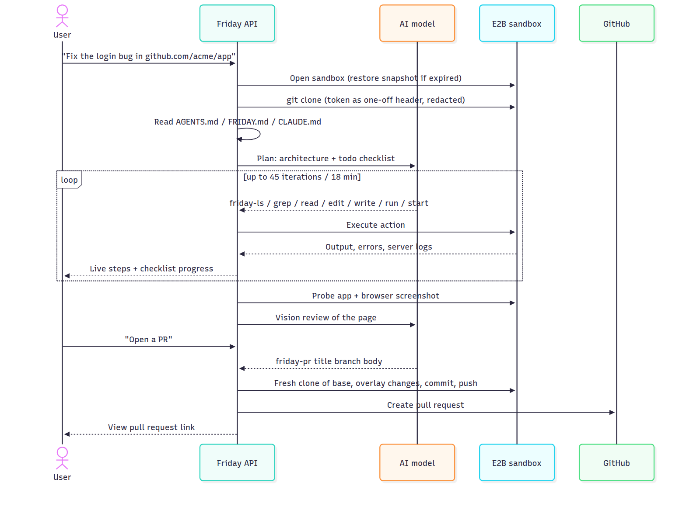
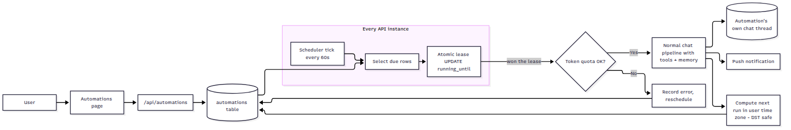
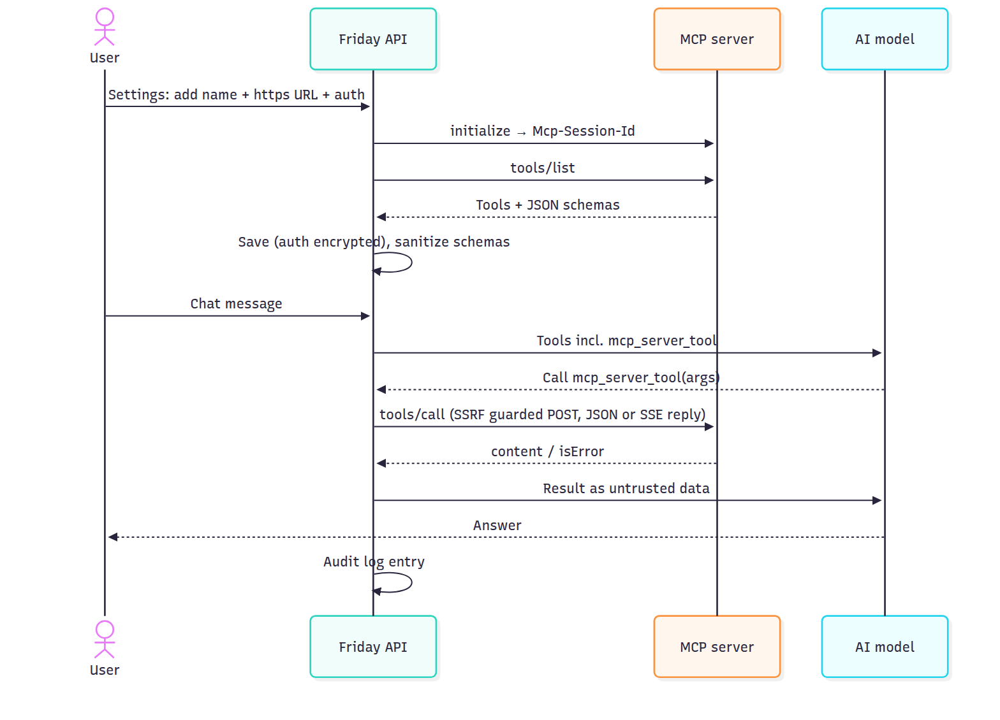

# Friday AI — copy for your boss

**Branch:** `claude/architecture-analysis-p7x2lr` · **Folder:** `docs/diagrams/`

Friday AI is now an agent platform, not only a multi-model chat app: models use real tools (web search and full page reading, code execution, the user's connected GitHub / Gmail / Drive / Calendar / Notion / Vercel / Railway / Supabase / Razorpay, and any MCP server), remember users across chats, run scheduled Automations, and Build Mode works like a coding agent that can open GitHub pull requests.

**Users can** chat with any model (Single / Auto / Team Up), turn on Deep Research for cited reports, let Friday remember facts, schedule daily/weekly automations with push notifications, search every past message, share read-only chat links, connect apps and MCP servers, build and run projects, and pay on Razorpay.

**To go live** apply Supabase migrations `0001`–`0027`, set production secrets, deploy, then check `/api/health/ready`.

Download the full pack: [friday-ai-diagrams.zip](./friday-ai-diagrams.zip) or open [BOSS_PACK.html](./BOSS_PACK.html) and Print → Save as PDF.

## System architecture

## What the system can do

## What users can do

## How chat works (agent loop)

## How login works

## How Razorpay billing works

## How connectors and MCP tools work

## Data model

## Identity and access

## Go-live checklist

## Agent tool loop

## Build Mode coding agent + GitHub PRs

## Automations scheduler

## MCP servers

