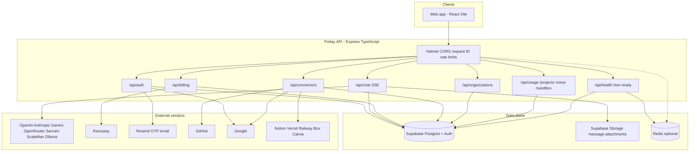
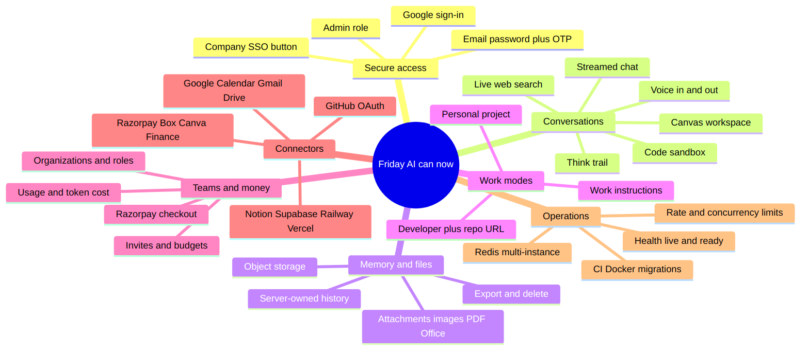
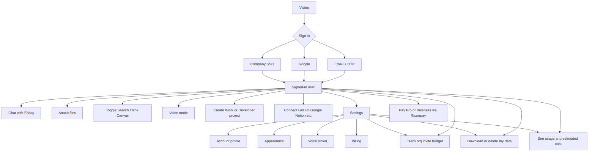
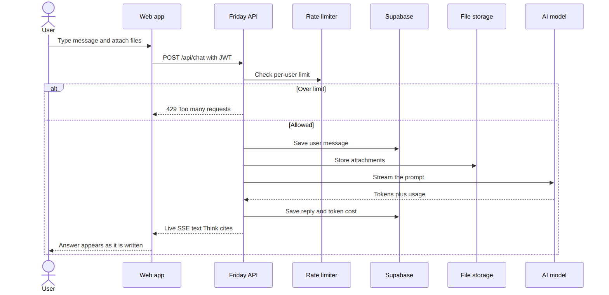
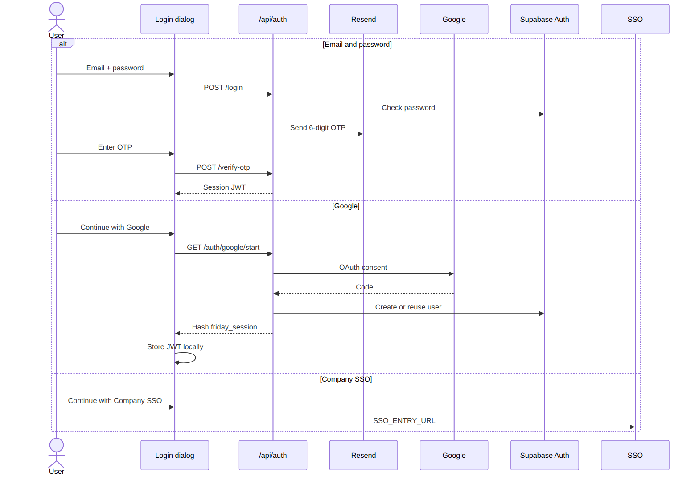
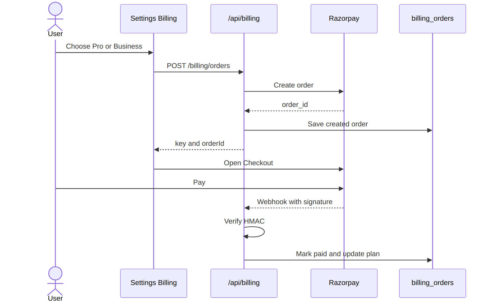
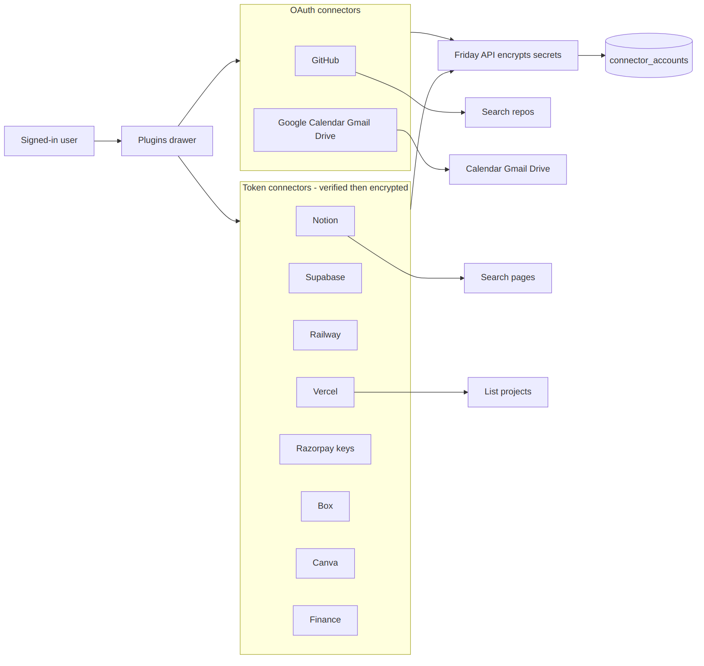
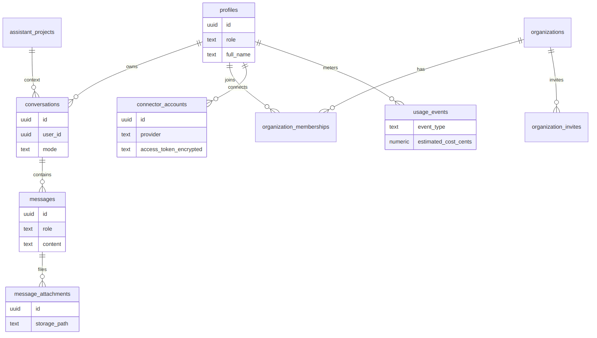
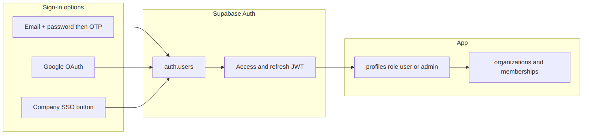
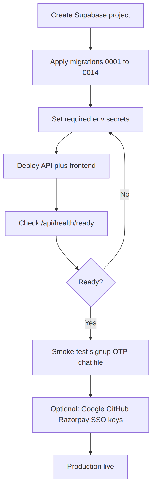

# Friday AI — copy for your boss

**Branch:** `cursor/cloud-agent-1789643679414-qaev6` · **PR:** #2 · **Folder:** `docs/diagrams/`

Friday AI is now a production-shaped assistant platform: secure login, saved chats and files, teams, Razorpay billing, app connectors, and usage/cost tracking.

**Users can** sign in (email OTP, Google, or company SSO), chat, attach files, use Search / Think / Canvas / voice, create Work or Developer projects, connect GitHub/Google/Notion and other tools, pay on Razorpay, and export or delete their data.

**To go live** apply Supabase migrations `0001`–`0014`, set production secrets, deploy, then check `/api/health/ready`.

Download the full pack: [friday-ai-diagrams.zip](./friday-ai-diagrams.zip) or open [BOSS_PACK.html](./BOSS_PACK.html) and Print → Save as PDF.

## System architecture

## What the system can do

## What users can do

## How chat works

## How login works

## How billing works

## How connectors work

## Data model

## Identity and access

## Go-live checklist

