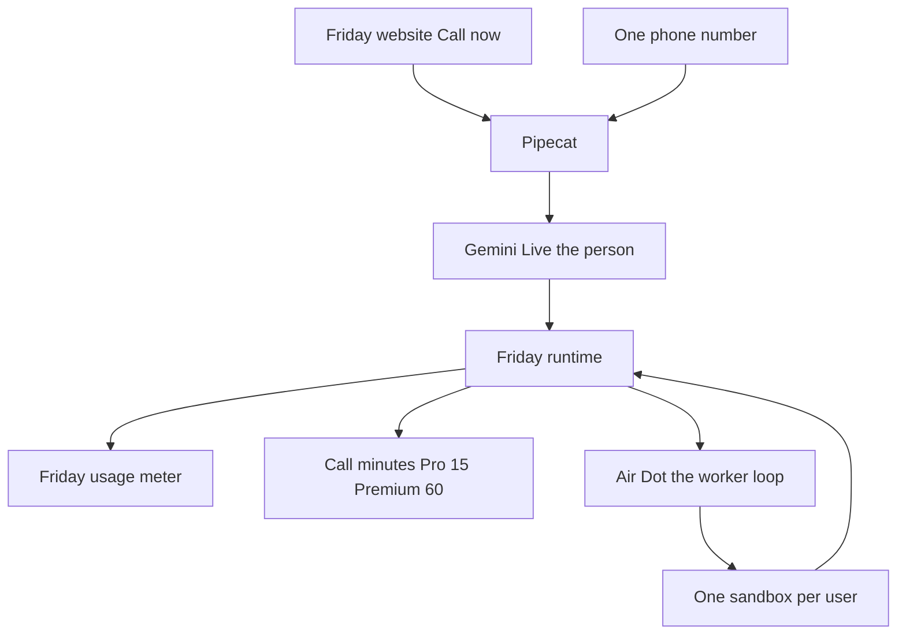

# Air Dots

Friday is the product. Air Dots is the always-on computer inside Friday, and the call that drives it.

The person on the phone is Friday. The button on the website says **Call now**. The surface that button opens is **On Air**. There is no second app, no second login, and no second usage meter for the work. Call minutes are the only extra limit, and they show up only on Pro and Premium.

This replaces the earlier "Friday line" name. The runtime, the hold-or-release rule, the persona, and the call memory still stand. They now sit under Air Dots.

## What we looked at

| System | What it actually is | What Air Dots keeps | What we leave |
|---|---|---|---|
| OpenDots | Always-on coworkers, each with a computer, text and calls sharing one context | Call stays up only for the talk. The computer keeps working. Approval before a save or a send. | A new workspace, Spaces, Slack, and one computer per specialist |
| OpenBot | Any agent, one gateway that allows and records every computer action, one container per coworker | One gate in front of the browser, the shell, and files. An audit row for every action | Thirteen example bots and a second product to sign into |
| Rakazo | Persistent teammates, a private computer, routines, voice, web plus desktop plus mobile | One computer per user, paused when idle, routines, the web as the home | Electron, Expo, and a bring-your-own meter |
| Coucou | A notch pet that watches coding sessions on your Mac | Tell the person when Friday needs them | A desktop mascot |
| Grok build | A loop that keeps going, with a graph of the work, until the task is done | That loop, inside the user's sandbox, until the job is done or the meter is empty | A separate CLI product for this feature |

Air Dots is not a clone of any of these. It is Friday's existing account, Friday's existing meter, and Friday's existing sandbox, with a loop that does not die when the call ends.

## The shape

Two brains, on purpose.

- **Friday on the call** is Gemini Live, audio to audio. She talks, she listens, she stops. She does not run the computer.
- **The Air Dot** is the worker. It is the same kind of loop Grok build uses: tools, a graph of the job, and it keeps going until the task is done. It runs in the user's sandbox. Its tokens come out of the Friday usage meter, the same meter as chat and Build Mode.

The call can start a job, hear a short result, or hang up while the Dot keeps working. When the job is done, or when they asked to be called, Friday rings them.

## The sandbox

Friday already has this. One E2B machine per user, paused when idle, resumed next time, with files and browser logins kept. Air Dots uses that machine. It does not create a second one.

Cost control is a limit, not a new product:

- Idle for the admin limit, starting at 8 minutes with no step running, and the machine pauses.
- The job does not disappear. The next step resumes the same machine.
- A hard awake cap per day stops a runaway loop from holding a machine open. The work is kept. Friday says the meter or the cap stopped it.
- Shell, browser, and files never run on Friday's own server. If the sandbox is down, the tool fails clearly.

The sandbox is how Friday uses a browser, logs into a site, uses a connector, runs a skill, and uses Build Mode. Zomato, Swiggy, and Walmart are not plugins. They are sites in that browser. Friday can search, click, and fill. She asks before she pays, sends, or deletes. The passphrase covers that yes when the action leaves the account.

## The loop

The Air Dot is not a scheduled prompt. Friday already has those automations. An Air Dot is a job with a graph:

- It plans the steps.
- It runs them in the sandbox.
- It checks the result and continues.
- It stops when the task is done, when the person says "rukho" or "stop", or when the Friday usage meter is empty.

Scheduling and automations stay. "Every morning, order nothing, just tell me the traffic" is still an automation. "Book the table, then message them, then stop" is an Air Dot that runs until that graph is done. Both write into the same Friday thread. Both spend the same usage meter.

The model behind the loop is chosen in the Team Console. Do not bake Fable, Astra, or any other name into the client. Start the loop on the same model Build Mode already uses, so the power and the bill match a job the person could have typed. Swap the model in admin when you pick Fable, Astra, or whatever wins the test. The voice model is not this model.

## The call

### Call now

On the Friday website, **Call now** sits on On Air. The click places a call to the mobile number on the account. Friday is already talking when they pick up. The website stays the home. No new app.

### They call Friday

One number. India and international are two trunks on that same gateway, not two products.

- India: an Exotel number.
- Everywhere else: Telnyx or Twilio.
- Pipecat is the pipe between that number and Gemini Live. Pipecat does not sell the number.

A personal Jio SIM can prove one inbound call on a desk. It cannot be the number users call. It will not route, record, or scale, and it will not cover a user outside India.

### Who is calling

The caller ID matches the verified number on the account. That is the login. Unknown numbers hear one sentence and the call ends.

A passphrase is for the moments that need a second check, not for every hello. The person sets it by talking: "my passcode is jagga jasoos." Friday stores a hash. She asks for it before a payment, a send, or a delete, and when a call arrives from a number that is not on the account yet. They can change it the same way.

### Minutes

Call minutes are a separate counter. They are not the Friday usage meter.

| Plan | Call minutes each month | Where it shows |
|---|---|---|
| Free | none | Call now stays hidden |
| Pro | 15 | Visible only while Pro is selected |
| Premium | 60 | Visible only while Premium is selected |

Agent work started from a call, from the website, or from a schedule spends the normal Friday meter. A loop that runs for an hour after hang-up does not spend call minutes. Only the time the phone line is up spends them.

Short work, about 5 to 10 seconds, stays on the line. She says she is getting it, then speaks the result. Longer work leaves the line. "Stay with me" is allowed and spends minutes.

### What a minute costs us

Gemini 3.8 Live, published paid rates: about $0.005 per minute of audio in and $0.018 per minute of audio out. If both sides talked for a full minute, that is about $0.023, roughly ₹2 at ₹84 per dollar. A normal call is less, because nobody talks the entire minute.

That headline is not the whole bill. Gemini re-bills the audio still sitting in the session on later turns. Without compression, a long call costs more than the headline and can die around 15 minutes. Air Dots turns compression on, and the call memory that matters is text, not a pile of raw audio.

Add the phone trunk, about ₹0.5 to ₹1.5 per minute in India. Plan on about ₹3 to ₹5 of direct cost per connected minute once compression is on, before the worker model. The worker is extra, and it is already inside the Friday meter.

At that range, 15 Pro minutes are about ₹45 to ₹75 of call cost. 60 Premium minutes are about ₹180 to ₹300. Those are our cost, not the price. The usage meter still covers the sandbox and the loop.

Grok audio-to-audio can replace Gemini Live later from the same admin switch, if its speech API is the one you want in production. Do not block the first build on it. Pipecat can point at either.

## Memory

Three layers, all on the verified account, never on the raw phone number alone.

1. **This call.** The transcript, stored when the line drops.
2. **The recap.** Last job, last place the result went, open loops. Capped. Injected next time. She does not recite it as a greeting.
3. **The person.** The same Friday memory chat already uses. Preferences, names, the passphrase hash. The curious line may use one fact from it, then wait.

Memory never grants a payment or a send.

## How she sounds

This is the system prompt, not a voice vendor setting.

Short spoken sentences. One idea, then stop. English or Hindi. A real reaction to the last thing they said, then the task. One question at a time. One curious beat when the job allows it, specific to what they just said, then silence. No "sure", no "anything else?", no fun facts. She does not talk over them. Barge-in cuts her mid-sentence.

She should feel like a sharp person who is sitting there for them. Friendly, a little curious, never a menu.

## What she can do

Anything the sandbox and Friday's connectors can already do, plus the jobs the loop finishes after the call:

- Build Mode, documents, research, mail, skills
- Browser search and any site the person can log into
- Connectors Friday already has
- Schedules and automations
- An order on Zomato, Swiggy, or Walmart, stopped for a spoken yes before money moves

No plugin is added per website. If a site has no connector, the sandbox browser is the connector. If Friday is missing a tool, it is one tool on the existing runtime, not a new app.

## What not to add

- A Friday Air app, a dots app, or a second install
- A new meter for agent work
- A computer per specialist
- A personal SIM as the public number
- The voice model running the long loop

## Build order

1. **The Air Dot.** A job that loops in the existing per-user sandbox until it is done, paused, or out of meter. Idle pause and the awake cap. The website can start one before any phone exists.
2. **The gate.** Every browser, shell, and file action is allowed and recorded. Pay, send, and delete wait for a yes.
3. **Call now, outbound only.** Pipecat, Gemini Live, Exotel, the verified number, the 15 and 60 minute counters, hidden unless the plan is Pro or Premium.
4. **The inbound number.** Caller ID login, passphrase for the dangerous yes, India plus international trunks.
5. **She rings back** when the Dot finishes, or when they asked, inside the remaining minutes and quiet hours.

The website gets Call now in step 3. The always-on computer is already real in step 1.
